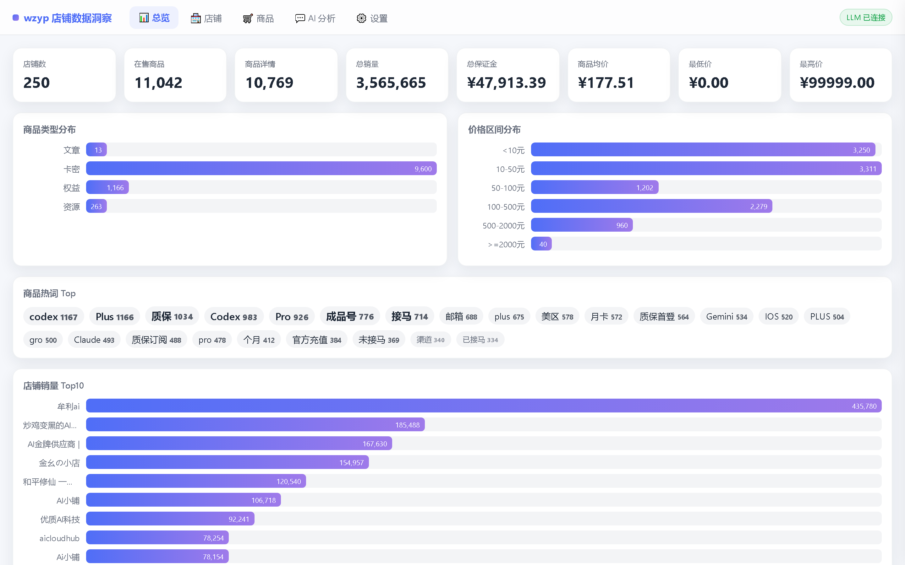
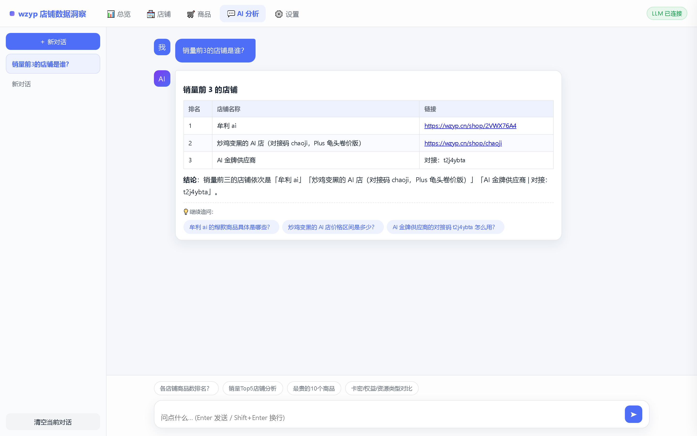
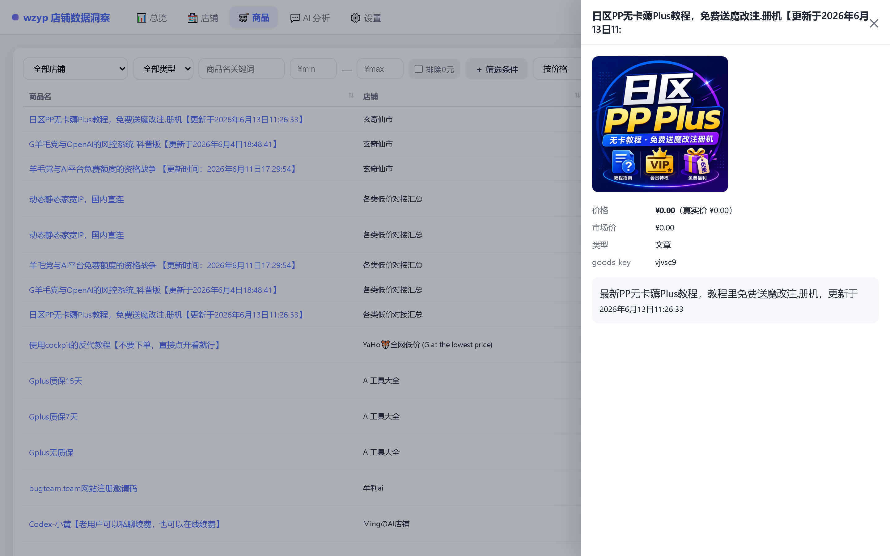
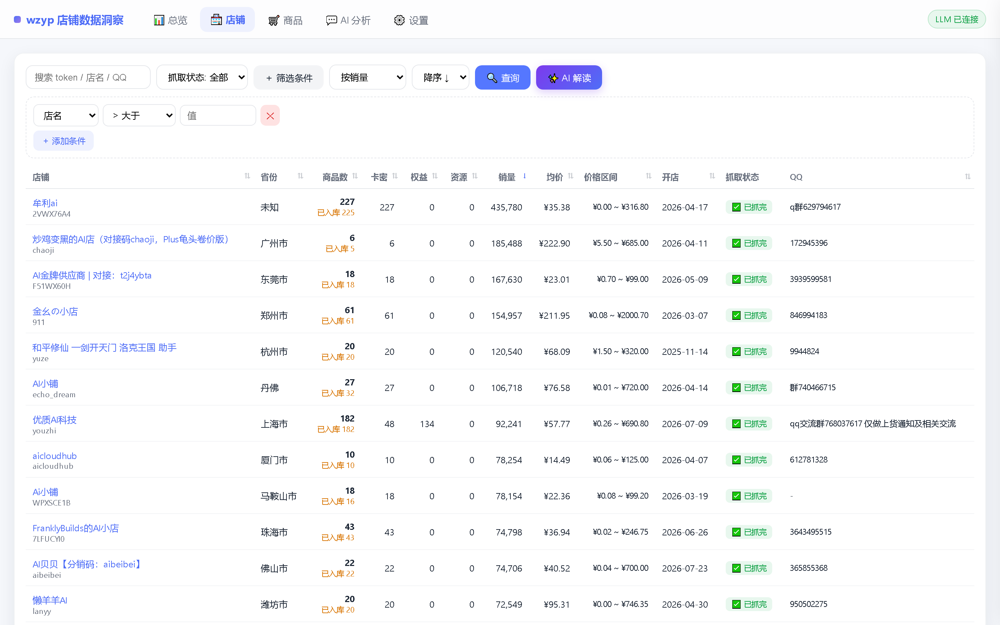
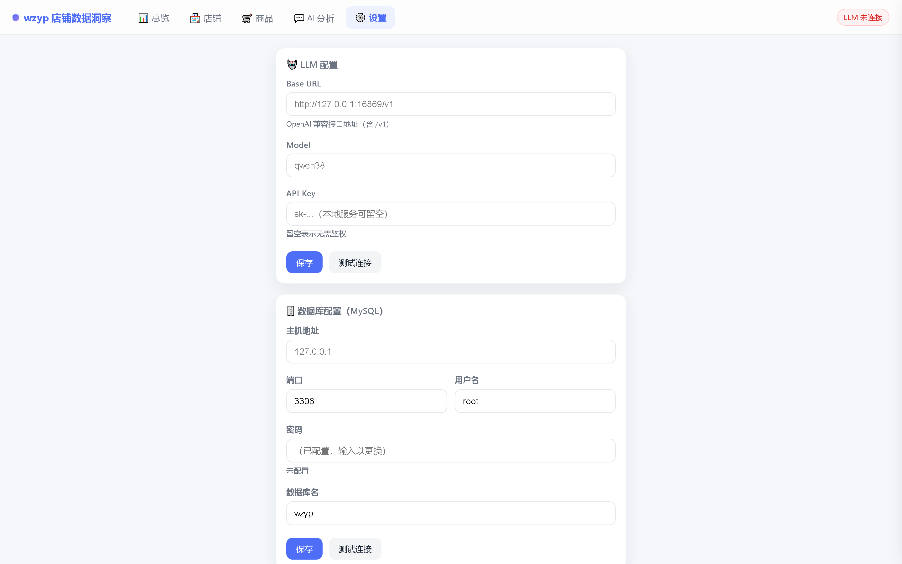

# wzyp-view — 链动小铺店铺数据洞察

[wzyp.cn（链动小铺寄售平台）](https://wzyp.cn) 全站 **250 家店铺 / 11,042 件在售商品** 的数据可视化与 LangGraph AI 分析工具。

> 🎨 **[在线宣传页](https://samge0.github.io/wzyp-view/)** — 功能总览 · AI 架构 · 快速开始

- 📊 可视化总览：统计卡 / 商品类型分布 / 价格区间 / 热词云 / 销量 Top10，**全部支持点击下钻**到对应筛选结果
- 🏪 店铺 / 🛒 商品多维查询：字段筛选构建器（≥/≤/like…）、表头+下拉双排序、抓取状态筛选、排除 0 元、商品详情抽屉
- 💬 AI 分析：LangGraph Agent 流式对话（markdown 渲染、自动追问建议、多会话管理），支持「AI 解读」把当前查询结果一键带入聊天
- ⚙️ 页面化配置：LLM 与 MySQL 连接全部在网页设置页配置（保存前自动测连、热生效），支持配置导入/导出

## 界面预览

**📊 数据总览** — 一屏掌握全站规模，所有卡片与图表可点击下钻：



**💬 AI 分析** — 自然语言查询，流式 markdown 回复 + 自动追问建议（回答引用真实库内链接）：



**🛒 商品查询 + 详情抽屉** — 多维筛选，点击商品名查看 HTML 描述全文：



**🏪 店铺列表** — 关键词搜索 + 字段筛选构建器 + 双排序，含抓取状态徽章：



**⚙️ 设置页** — LLM 与 MySQL 页面化配置、连通测试、配置导入/导出：



## 📱 Android v6 · 直接刷新公开店铺 + 离线数据库 + AI API

- [Android APK 下载](../../releases) · [GitHub Actions 构建](../../actions/workflows/android-apk.yml)
- [详细配置和构建指南](android-app/README.md)
- 店铺、商品、图表、筛选、详情：使用手机内置 SQLite，可完全离线使用。
- **数据更新：** 安卓设置页支持从手机文件导入 `.db/.sqlite`、或从自定义 HTTPS 地址下载数据库快照，验库后替换；支持恢复内置快照。
- **直接更新：** 支持从链动小铺公开店铺商品列表接口按现有店铺分页刷新商品价格/上架状态，支持指定新店铺链接导入、可选每日 Wi-Fi 后台批量检查。公开 API 可能随平台调整或限制访问，不绕过验证。
- **数据来源：** 如有新 MySQL 数据，也可用 [`tools/export_mysql_snapshot.py`](tools/export_mysql_snapshot.py) 导出为手机用的 SQLite。原上游仓库不提供实时自动更新服务，需自行准备新的数据文件。
- **AI 分析：** Android 设置页可自行填写 OpenAI Chat Completions 兼容 **Base URL / Model / API Key**；支持测试连接并可切换回本地规则分析。
- API Key 由 Android Keystore 加密保存；公网要求 HTTPS；使用在线 AI 时只向自选服务商提供相关统计摘要与问题，不上传完整数据库。
- **注意：** 在线 AI 需要网络；原生 Anthropic/Gemini 等非 OpenAI 兼容协议需网关适配。历史快照不可当作实时商品数据。

## 快速开始

### 方式一：本地运行（uv）

#### 1. 准备数据

从 [Releases](../../releases) 下载 `wzyp-data.zip`（约 16 MB，含三张表全量数据），解压后导入 MySQL：

```bash
# 创建数据库
mysql -u root -p -e "CREATE DATABASE IF NOT EXISTS wzyp DEFAULT CHARSET utf8mb4 COLLATE utf8mb4_unicode_ci"

# 按顺序导入（ shops 先导，goods 有外键依赖 ）
mysql -u root -p wzyp < wzyp_shops.sql
mysql -u root -p wzyp < wzyp_goods.sql
mysql -u root -p wzyp < wzyp_goods_detail.sql
```

> 也可以在 `mysql` 交互终端里用 `SOURCE wzyp_shops.sql;` 的方式逐个执行。
> 压缩包内附 `README-IMPORT.txt` 说明。

#### 2. 创建虚拟环境（[uv](https://docs.astral.sh/uv/)）

```bash
cd wzyp-view

# 创建虚拟环境（默认 .venv，Python ≥ 3.11）
uv venv --python 3.13

# 安装依赖（国内可加 --index-url https://pypi.tuna.tsinghua.edu.cn/simple）
uv pip install -r requirements.txt
```

#### 3. 启动

```bash
# 激活虚拟环境
#   Windows (cmd):
.venv\Scripts\activate
#   Windows (PowerShell):
.venv\Scripts\Activate.ps1
#   Linux / macOS:
source .venv/bin/activate

# 启动服务
python run.py
```

> 不激活环境也可以直接跑：`.venv\Scripts\python.exe run.py`（Windows）或 `.venv/bin/python run.py`（Linux/macOS）

#### 4. 配置并使用

浏览器打开 **http://127.0.0.1:8770** → 进入 **⚙️ 设置** 页：

1. **🗄️ 数据库配置**：填 MySQL 地址 / 端口 / 账号密码 / 库名（`wzyp`），点「测试连接」确认后保存
2. **🤖 LLM 配置**：填任意 OpenAI 兼容接口（DeepSeek / 智谱 / 本地 vLLM / Ollama…）的 Base URL、Model、API Key，测试保存

配置持久化在 `data/settings.json`，重启不丢。也可复制 `data/settings.example.json` 手动编辑，或使用环境变量（见下）。

### 方式二：Docker

```bash
git clone https://github.com/Samge0/wzyp-view.git
cd wzyp-view
docker compose up -d --build
# 访问 http://localhost:8770
```

- 配置同样走页面设置（持久化在 `./data` volume）
- 容器内访问宿主机 LLM 服务用 `http://host.docker.internal:16869/v1`
- 也可用环境变量注入配置（优先级高于页面）：

```yaml
environment:
  WZYP_DB_HOST: 127.0.0.1
  WZYP_DB_PORT: "3306"
  WZYP_DB_USER: root
  WZYP_DB_PASSWORD: "your-password"
  WZYP_DB_DATABASE: wzyp
  WZYP_LLM_BASEURL: http://host.docker.internal:16869/v1
  WZYP_LLM_MODEL: qwen38
  WZYP_LLM_APIKEY: ""
```

## 数据说明

| 表 | 行数 | 说明 |
|----|------|------|
| `wzyp_shops` | 250 | 店铺（token 主键、销量、保证金、联系方式、`fetch_done` 抓取状态） |
| `wzyp_goods` | 11,042 | 在售商品（goods_key、店铺外键、类型 card/article/resource/equity、价格） |
| `wzyp_goods_detail` | 10,769 | 商品详情（HTML 描述全文、图片、真实价） |

数据采集自公开接口（2026-09 快照），少量差额为采集期间已下架商品。数据仅供学习研究，请勿用于商业用途。

## AI 架构（LangGraph）

```
planner(LLM+bind_tools) ⇄ tools(只读SQL+schema) → END
```

**防幻觉设计**（本地小模型实测打磨）：

- schema 动态行数 + few-shot 示例 SQL + 「仅有 3 张表」显式声明，防表名幻觉
- SQL 报错自动回灌纠正提示（Unknown table/column → 引导核对 schema 重写）
- 工具结果渲染为竖线表格「直喂」，防 JSON 转录失真
- 系统提示每轮重注入 + data_schema 后强提示「无数据行」
- 追问轮防复读提示

**记忆体系**：JSON 长期记忆（跨请求会话持久化，`data/chat_memory.sqlite.json`）+ 24 条滑动窗口 + 历史摘要压缩。

## 项目结构

```
wzyp-view/
├── server.py          # FastAPI（静态 + 数据API + SSE + 设置/导入导出API）
├── agent.py           # LangGraph Agent（工具/记忆/流式/追问建议）
├── db.py              # MySQL 查询层（连接池，配置热重建）
├── config.py          # 配置加载（settings.json + env，llm/db 双段）
├── static/index.html  # 前端 SPA（原生 JS 单文件）
├── data/              # settings.json + 聊天记忆（运行时生成，已 gitignore）
│   └── settings.example.json
├── requirements.txt
├── Dockerfile / docker-compose.yml / .dockerignore
└── 启动.bat            # Windows 一键启动
```

## 常见问题

- **端口占用**：`WZYP_PORT=9000 python run.py` 换端口
- **数据库连不上**：设置页「测试连接」会返回具体错误；确认 MySQL 允许该主机访问
- **LLM 401**：vLLM 本地服务也要填 API Key；Ollama 留空即可
- **容器内 LLM 连接失败**：Base URL 用 `http://host.docker.internal:<port>/v1` 而非 `127.0.0.1`

## License

MIT
